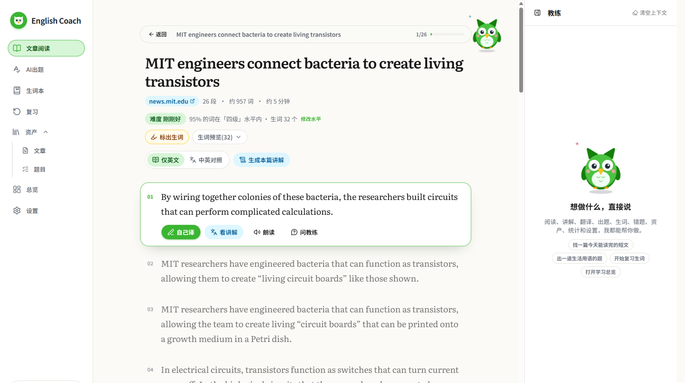
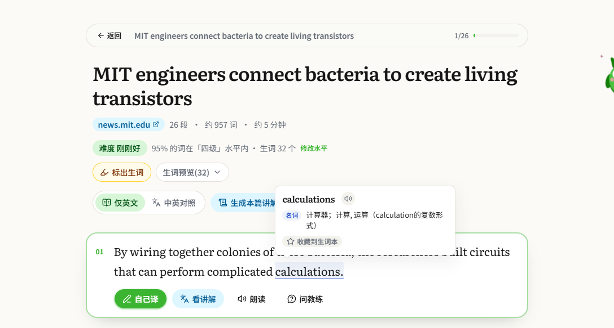
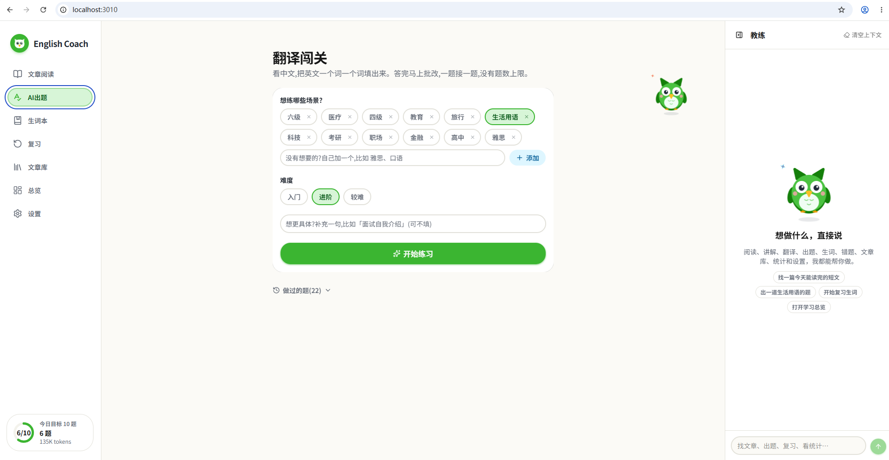
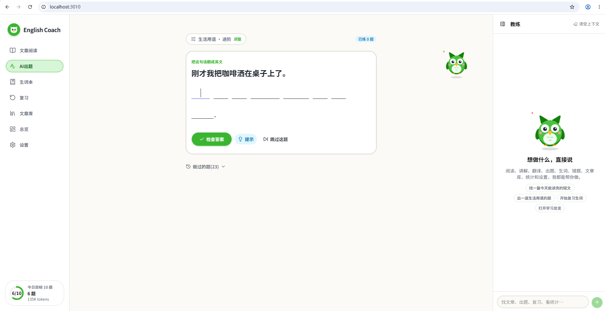
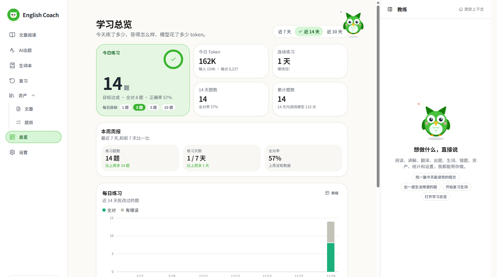

# English Coach

[](./LICENSE)
[](https://www.typescriptlang.org/)
[](https://nextjs.org/)

**Agent-powered English reading workbench** — pull real articles, hover for offline glosses, translate / explain paragraphs, run AI drills & dialogue, and review mistakes. The coach agent shares the same workspace as the UI.

> 读真实的英文文章，边读边练：悬停查词、段落讲解、AI 出题、对话模式、错题复习。一个会“动手”的 AI 教练，和页面共享同一个工作区。

开源的英语阅读练习工作台，基于 Next.js + LangChain.js，数据全部存在本地 SQLite（隐私友好，适合个人或本地部署）。

## 截图

**文章阅读**：拉进一篇英文后按段阅读。可以标出生词、看难度，并对当前段自己译、看讲解、朗读或问教练。



**悬停查词**：离线 ECDICT，不调用大模型。卡片含词性、释义，并可收藏到生词本。



**AI 出题**：选场景标签和难度（入门 / 进阶 / 较难），也可以自己补充方向。



**翻译闯关**：把中文按词填成英文，再逐词批改。



**学习总览**：今日目标、周报，以及练习和 token 用量。时间范围可选近 7 天、近 14 天、近 30 天或全部。



## 特性

- **拉文即读**：粘贴 URL，或直接对教练说“帮我找一篇关于 xxx 的文章”。用 Scrapling 抓取整页，失败时回退到 Mozilla Readability，并保留各段正文。拉取中首页会显示翻书动画；本机访问不到的站点会较快失败并提示改链接或粘贴正文。
- **离线悬停查词**：基于 [ECDICT](https://github.com/skywind3000/ECDICT)，不调用大模型；支持 `in spite of`、`look up` 等多词短语的整段高亮，卡片含音标、词性与中文释义。
- **段落 / 本篇讲解**：选中段落点 **看讲解**，或点 **生成本篇讲解** 流式生成按句英中对照与短语 / 生词（英文按原文拆句显示，讲解只插入中文；一次模型调用，按段产出；每段写完即上屏并搬运）。点 **问教练** 时，当前段全文会放进教练上下文，用来讲难点和句子结构。也可 **自己译**，保存后让教练检查。
- **AI 出题**：按标签（生活用语、初中、四级……或自建）和难度生成中文句，英文按词留空，提交后逐词批改。
- **对话模式**：沿用同一套场景标签与难度，自由打字回一句英文（非填空）；AI 会解释你的说法、给出地道表达，再说下一句并自动朗读。
- **错题本与生词本**：错题可跳回原文段落；生词本使用间隔重复（Leitner 阶梯）复习。文章、题目、生词和错题列表按页从数据库读取。
- **学习总览**：每日目标、周对比与用量统计。Token 可按近 7 / 14 / 30 天或全部查看，数字与教练回答一致。
- **教练能控全部页面**：聊天与页面共享状态。Agent 可以找文、讲解、翻译、出题、开始对话、复习生词和错题、管理资产（文章 / 题目）、打开学习总览，以及修改每日目标、水平和发音。

## 快速开始

需要 Node.js 18+。可选：Python 3（用于 Scrapling）。

### 配置

先准备 `.env.local`（没有的话可从 `.env.example` 复制），任意 OpenAI 兼容端点均可：

```ini
LLM_API_KEY=sk-...
LLM_BASE_URL=https://api.openai.com/v1
LLM_MODEL=gpt-4o-mini

# 可选
# DATABASE_PATH=   # SQLite 路径，默认 ./data/english-coach.sqlite
# ECDICT_PATH=     # 词典路径，默认 ./data/stardict.db
# TAVILY_API_KEY=  # 教练联网搜索（见下），可不填
```

| 环境变量 | 作用 |
| --- | --- |
| `SKIP_SETUP=1` | 跳过 `npm run dev` / `start` 前的自动准备 |
| `SKIP_DICT=1` / `SKIP_SCRAPLING=1` | 分别跳过词典下载 / Scrapling |
| `PYTHON` | `python` 不在 `PATH` 时指定解释器 |

### 安装与启动

```bash
git clone https://github.com/lcy2021/EnglishCoach.git
cd EnglishCoach
npm install
npm run dev
```

- **`npm install`**：只装 Node 依赖，**不会**下载词典。
- **`npm run dev` / `npm start`**：启动前会跑 `predev` / `prestart` → `scripts/ensure-setup.mjs`。这时若还没有 ECDICT，才会下载到 `data/stardict.db`（约两百兆压缩包，可能要几分钟；已存在则跳过）。同一次还会在缺少 `.env.local` 时从示例复制，并在有 Python 时按需安装 Scrapling。

也可手动：`npm run setup`（完整准备）或 `npm run dict:fetch`（只下词典）。pip 卡住时可换 PyPI 镜像。

`npm install` 会读取项目里的 `.npmrc`（`ignore-scripts=true`）。`better-sqlite3` 13 已带上各平台预编译包，安装时直接使用这份二进制。Node.js 22 自带的 npm 10 在看到 `binding.gyp` 时仍会调用 node-gyp；在没有可用 C++ 工具链，或只有 Visual Studio 2026 的机器上，这次编译会失败。

打开 [http://localhost:3010](http://localhost:3010)。每个页面有自己的地址（如 `/stats`、`/drill`、`/converse`、`/vocab`），刷新后仍停在当前页。文章阅读在 `/`。进入某个页面只请求该页自己的数据；侧栏的今日目标和生词数量随首次打开一起带上，换页时不再另发请求。客户端换页时顶部会显示一条主题色进度条（`nextjs-toploader`）。

## 使用流程

1. **拉文**：粘贴 URL 点拉取，或让教练在聊天里找一篇。
2. **阅读**：悬停单词查释义；选中段落点 **看讲解**，或点 **本篇讲解** 处理全文。点 **问教练** 会带上这一段全文。
3. **翻译**：用 **自己译** 写下译文并保存，让教练检查。
4. **出题**：进入 **AI出题**，选标签与难度，填空并获得逐词批改。
5. **对话**：进入 **对话模式**，用同一套标签和 AI 一人一句打字练口语。
6. **复习**：在 **复习**（错题本）和 **生词本** 中回顾。

## 技术栈

| 层 | 选型 |
| --- | --- |
| 框架 | Next.js 15（App Router）、React 19、TypeScript、Tailwind CSS、nextjs-toploader（路由顶栏进度） |
| Agent | LangChain.js / LangGraph、`@langchain/openai` |
| 聊天 UI | [assistant-ui](https://www.assistant-ui.com/)，SSE 流式回复 |
| 存储 | SQLite（`better-sqlite3`） |
| 抓取 | Scrapling（Python），回退 Mozilla Readability + jsdom |
| 词典 | ECDICT（离线） |
| 状态 | Zustand |

## 项目结构

```
src/app/            页面与 API 路由
src/components/     工作室 UI
src/lib/agent/      LangChain 提示词、工具、运行循环
src/lib/db/         SQLite 访问与统计
src/lib/drill/      中译英按词填空出题
src/lib/converse/   一人一句口语对话
src/lib/explain/    段落讲解
src/lib/glossary/   ECDICT 查询与短语匹配
src/lib/fetch/      Scrapling 拉文，Readability 兜底
src/lib/vocab/      生词本间隔重复
src/lib/store/      客户端工作区状态
scripts/            ensure-setup.mjs、scrapling_fetch.py 等
.npmrc              安装时跳过原生模块编译，使用 better-sqlite3 预编译包
```

## 开发

```bash
npm run dev      # 开发服务器（端口 3010）
npm run build    # 生产构建
npm start        # 生产运行
npm test         # 单元测试
npm run lint     # 合并前请先通过
```

约定：UI 按钮与 LangChain 工具尽量共用后端能力；界面文案使用中文；背单词不是主循环，阅读才是。

## 已知限制

- 需要浏览器挑战的网站（强反爬）仍可能拉取失败。
- 教练的联网搜索默认使用 OpenAI / Azure OpenAI Responses API 的托管搜索，其他兼容端点没有这个能力。在 `.env.local` 填 `TAVILY_API_KEY`（[Tavily](https://tavily.com) 有免费额度）后，改用 Tavily 搜索，任何 LLM 厂商都能用，速度也更快；Tavily 失败时会退回托管搜索。不配置搜索时，仍可直接给链接或粘贴文字。

## Changelog

See [CHANGELOG.md](./CHANGELOG.md). Latest: **v0.1.0**.

## 许可

[MIT](./LICENSE)
